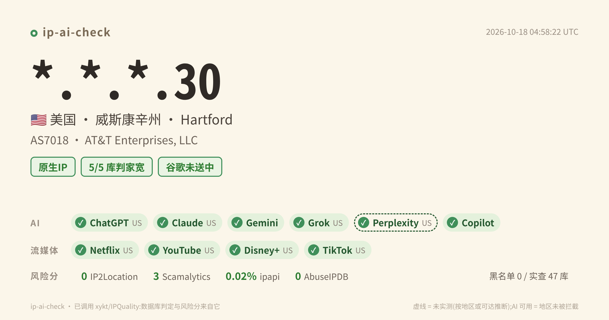

# ip-ai-check

一个侧重 **AI 服务可用性** 的 IP 质量检测工具。以前大家看一个 IP 能不能解锁奈飞，现在更关心 ChatGPT、Claude、Gemini 能不能用、谷歌有没有把它判成中国。



## 测什么

| 项目 | 怎么测 |
|---|---|
| **AI 服务** | ChatGPT、Claude、Gemini、Grok、Perplexity、Copilot，判断所在地区是否被拦截 |
| **谷歌送中** | YouTube 是否判为中国区（跳转 google.cn）、谷歌搜索是否被重定向到 google.com.hk |
| **Netflix** | 直接请求自制剧和非自制剧的页面，读 Netflix 自己判定的国家，区分 完整解锁 / 仅自制剧 / 不可用 |
| **IP 黑名单** | 内置 48 个经实测筛选的 IP 黑名单库，结果分为 黑名单 / 政策名单 / 解析器查不了 / 查询失败 |
| **数据库判定与风险分**（可选） | 调用 [xykt/IPQuality](https://github.com/xykt/IPQuality) 获取 IPinfo、ipregistry、ipapi、IP2Location、AbuseIPDB 等的 IP 类型判定、风险评分和风险因子 |

输出：JSON、文本报告、分享卡片（PNG）、可自托管的 HTML 报告页。**不上传任何数据。**

## 实测中发现的问题

做这个工具时，我们发现常见的 IP 检测方法有几处会给出错误结论：

1. **公共 DNS 会悄悄挡掉一部分黑名单查询。**
   用 8.8.8.8 查 Spamhaus，返回的是空，会被误判成「没列入」；1.1.1.1 直接返回拒绝码；9.9.9.9 能查 Spamhaus，但另外 5 个库查不了。
   所以本工具每个库先查一次测试点，查不了的单独标成「解析器查不了」，不再冒充「正常」。卡片上写的也是实际查到的库数，比如「黑名单 0 / 实查 46 库」。
2. **常用的黑名单列表大半已经失效。** 一份 423 个库的公开名单里，291 个库的域名已经不存在，14 个对任何地址都回「已列入」。用这种列表算出来的「已标记」很可能毫无意义。
3. **按 DNS 返回条数判断 Netflix「DNS 解锁」近乎抛硬币。** 公共 DNS 对 netflix.com 随机返回 2 条或 3 条地址，同一个 IP 连跑几次结果会来回变。

具体怎么测、怎么改的，见下面的「判定说明」。

## 用法

```bash
git clone https://github.com/<owner>/ip-ai-check && cd ip-ai-check

./run.sh                     # 检测本机
./run.sh 203.0.113.10        # 经 SSH 检测远程机器（需能 ssh root@IP 免密登录）
./run.sh 203.0.113.10 --full # 卡片和报告显示完整 IP（默认只露最后一段，如 *.*.*.56）
./run.sh --no-xykt           # 不调用 xykt 数据源，几十秒出结果

# 生成可分享的 HTML 报告页
PUBLISH_DIR=/var/www/html/ipq PUBLISH_URL=https://example.com/ipq ./run.sh 203.0.113.10 --publish
```

结果在 `reports/`：`*.json`（完整数据）、`*.txt`（文本报告）、`*.png`（卡片）。

HTML 报告页长这样（IP 默认打码）：[docs/sample-report.png](docs/sample-report.png)

只想在本机跑检测、不要卡片：`bash ip-ai-check.sh -o result.json`

依赖：被检测机器上有 bash、curl、jq、dig（缺了会用 apt 安装）；生成卡片需要 python3 和 chromium。
建议固定 xykt 脚本的版本：`XYKT_SHA256=<sha256> ./run.sh`，不符就拒绝运行。

## 判定说明

- **AI「可用」= 所在地区没有被该服务拦截。** Claude 和 Perplexity 的网站会拒绝脚本访问，只能按 Cloudflare 返回的地区对照官方支持地区来判断；账号层面的风控检测不到。
- **Gemini**：页面里出现正常加载的标记即为可用；被谷歌标记「异常流量」时会尝试带 cookie 自动放行，需要人机验证则标为「需验证」。
- **谷歌送中**：YouTube 判为中国区或谷歌搜索被重定向到 google.com.hk，任一出现即视为送中。
- **Netflix**：两部非自制剧页面都能打开 = 完整解锁；只有自制剧能打开 = 仅自制剧。

### 为什么不直接看 DNS 判断 Netflix「原生 / DNS 解锁」

有的脚本用「`dig netflix.com` 返回几条地址」来判断是不是 DNS 解锁：≤2 条就判 DNS。但公共 DNS 对 netflix.com 本来就随机返回 2 条或 3 条，我们对两个 IP 各采样 12 次，比例是 3:9 和 9:3，同一个 IP 连跑几次结果会来回变。所以这里改成直接看片源页面。

### 黑名单列表是怎么来的

从一份公开的 400 多个库的名单出发，按 [RFC 5782](https://www.rfc-editor.org/rfc/rfc5782) 的测试点逐个实测（2026-10）：查 `127.0.0.2` 必须返回「已列入」，查 `127.0.0.1` 必须返回「未列入」。结果：

- 约 290 个域名已经不存在（库早已关停）
- 十几个对任何地址都返回同一个结果（通配应答），查了没有意义
- 另有白名单、信誉评分类、只收录域名不收录 IP 的库，被列入不代表 IP 有问题

剔除这些后剩下 48 个真正可用的 IP 黑名单（含 Spamhaus），内置在 `ip-ai-check.sh` 里。另外：

- **每次检测前，先对每个库查一次测试点。** 测试点不返回「已列入」，说明当前用的 DNS 解析器查不了这个库，结果计为「解析器查不了」，不当作正常。
  实测（2026-10）：8.8.8.8 和 1.1.1.1 都查不了 Spamhaus ZEN（一个返回空、一个返回拒绝码），9.9.9.9 能查 Spamhaus 但查不了另外 5 个库，没有哪个公共解析器能查全。
  如果不做这一步，被解析器挡掉的库会悄悄显示成「没列入」。
- 指定查黑名单用的解析器：`DNSBL_RESOLVER=9.9.9.9`；用自建递归解析器（如 unbound）能查得最全。
- **Spamhaus PBL**（返回 `127.0.0.10/11`）是家宽和动态地址的政策名单，意思是「这类地址不应直接发邮件」，不代表有滥用行为，单独列为「政策名单」。
- 想用自己的列表：`DNSBL_LIST=zones.txt`，一行一个库。

## 致谢

各数据库的类型判定、风险评分和风险因子来自 [@xykt](https://github.com/xykt) 的 [IPQuality](https://github.com/xykt/IPQuality)（AGPL-3.0）。本工具在运行时下载并以隐私模式调用它，不包含、也不修改它的代码。

## 许可

MIT
